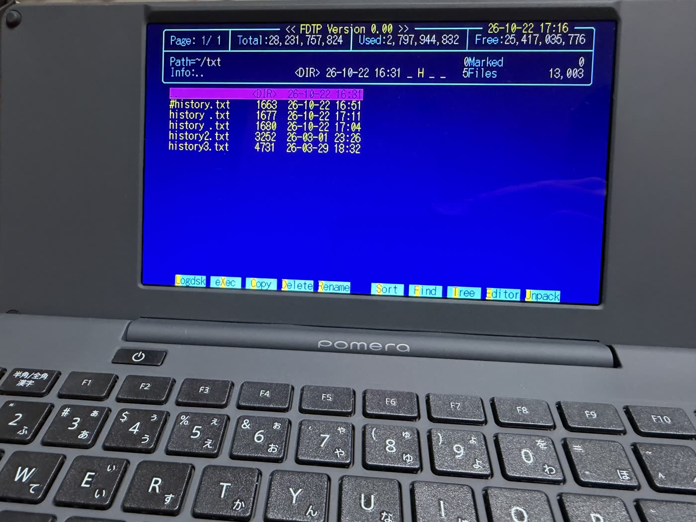
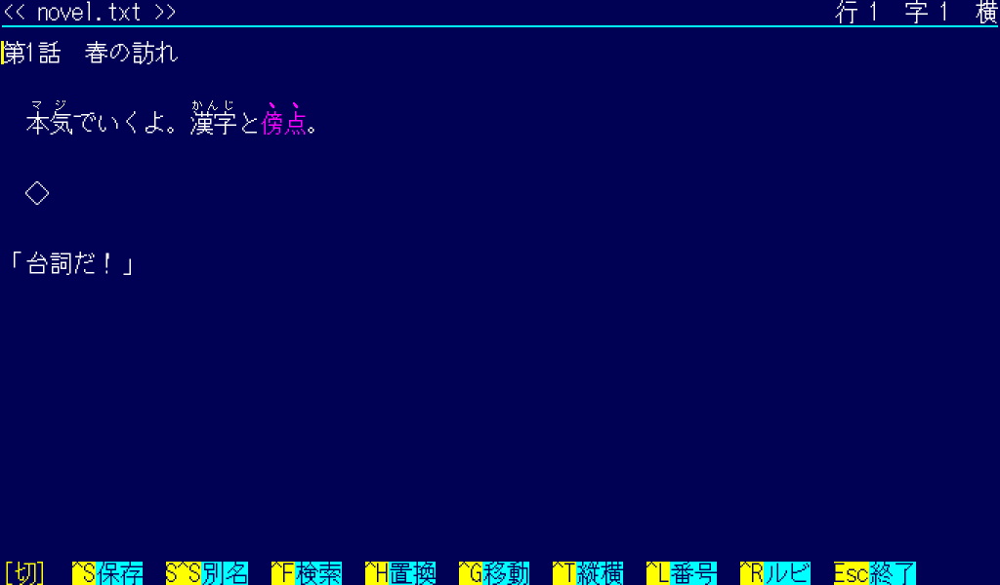
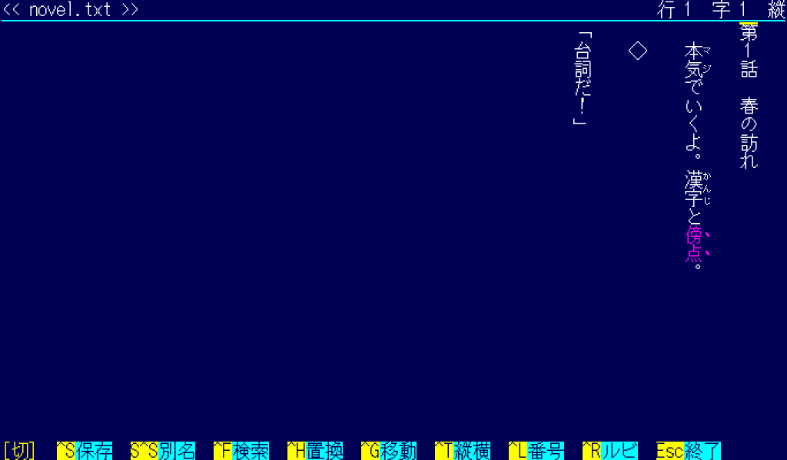
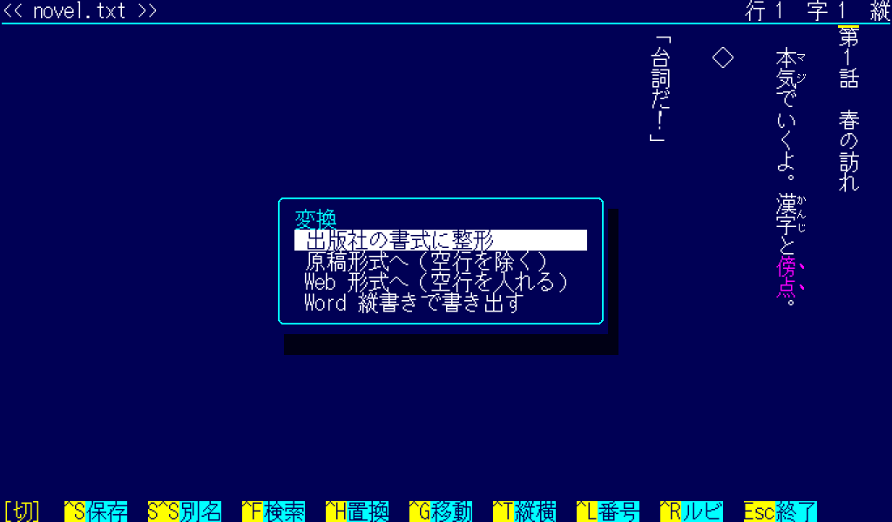
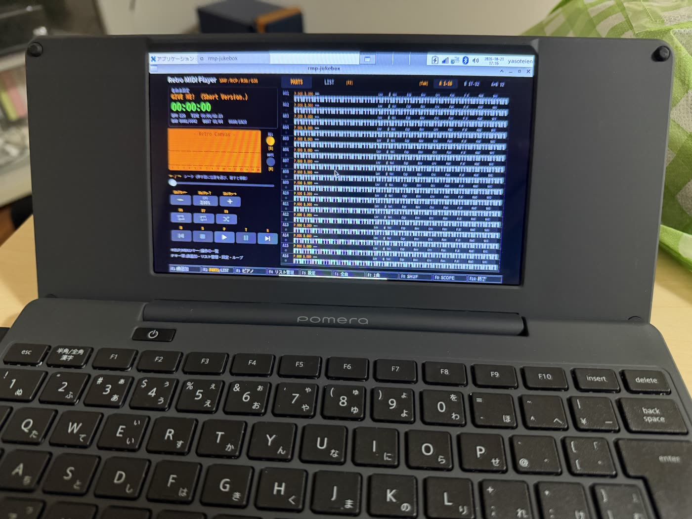

日本語 | [English](README.en.md)

# FDTP — File & Directory Tool for Pomera

<p align="center"></p>

<p align="center">
<b>✨ ポメラ純正ソフトにないから、ルビ振り対応の縦横表示エディタ作りました！ ✨</b><br>
（なろう・カクヨム対応、出版社向け整形付き）<br><br>
あ、ついでに画像・Excel・Word・PowerPoint・PDF も見えるファイラーもつけたよ！<br>
ついでのついでに、PDF の結合・分割・書き込みもつけたよ！<br>
パワポは F5 でスライドショーもできるよ！<br>
英語の画面もつけたよ！（US 版ポメラの人へ）🎉
</p>



FDTP は、キングジムのポメラ DM250 に Debian 13 を入れた環境で動くファイラーです。PC-98 で広く使われたファイラー FD 3.13 の画面と操作を手本にしています。DRM/KMS のコンソールでも、X11 のウィンドウでも動きます。

画面の言語は日本語と英語です。

- 初めて起動した時に、どちらを使うかを聞きます。答えは `~/.fdtprc` に書きます。
- あとから設定（`z`）や、`~/.fdtprc` の `LANGUAGE=auto|ja|en` で変えられます。
- `auto` のときは `LANG` に従います。`ja_*` なら日本語、それ以外は英語です。

## 主な機能

**ファイラー**
- FD 3.13 の内部コマンドとキーを持っています。コピー・移動・削除（ディレクトリも）・名前の変更・属性・ディレクトリの作成・ツリー・検索などです。`h` か `?` でキーの一覧が出ます。
- ポメラの Alt キーが使えます。Alt の操作は Shift+F1〜F10 と Ctrl+英字でもできます。
- 書庫: tar（gz・bz2・xz）・zip・LHa の閲覧・作成・解凍ができます。
- ファイルの分割（Alt+n。既定は 10 MB ごと）と結合（Alt+h）。
- システム情報（Alt+i）: 画面の出力、キーの装置、メモリ、ディスク、電池、GPU の省電力の設定などを見られます。

**ビューワとエディタ**（`v` か Enter）
- テキスト: 文字コード（Shift_JIS・EUC-JP・JIS・UTF-8・UTF-16）を選べます。行番号も出せます。`b` で 16 進表示です。
- PDF: ページを見るほか、ハイライト・下線・取り消し線・付箋を書き込めます。PDF の標準の注釈として保存するので、ほかの PDF のソフトでも見えます。
- PDF のメニュー（Alt+p）: 結合・分割・ページの抽出・削除・並べ替え・回転、パスワードの設定と解除、圧縮、PDF から JPEG、JPEG・PNG から PDF。どれもポメラの中だけで行い、外へは何も送りません。
- docx は段落を直せます。xlsx と csv はセルを直せて、よく使う関数は計算し直します。Ctrl+z で取り消し、Ctrl+y でやり直しです（既定で 100 段）。
- pptx: スライドの文字を直せます。F5 でスライドを画面いっぱいに出します（Esc で戻ります）。
- 画像: JPEG・PNG・GIF・BMP・WebP と、PC-98 の MAG・Pi。

**小説用エディタ**（`e` か F9）
- 日本語の原稿を書くためのエディタです。なろう・カクヨムのルビ記法（`｜漢字《かんじ》`、`《《傍点》》`）を、画面の上でルビと傍点にして見せます。縦書きでも横書きでも書けます。
- F2 で、出版社の書式への整形、原稿形式と Web 形式の切り替え、Word の縦書きの文書（.docx）の書き出しができます。
- 日本語入力は uim（Mozc）を使います。
- 英語の画面でも同じように使えます。変わるのは画面の文言だけです。

**画面**
- ポメラの 1024x600 の画面では、85 桁 25 行です。広い画面では `--size auto` や `--size 160x45` で桁と行を増やせます。
- X11 のウィンドウでは、Alt+Enter か F11 で全画面になります（`--fullscreen` で始めから全画面）。

```
fdtp [--kms|--x11] [--fullscreen] [--size auto|COLSxROWS] [DIRECTORY]
fdtp -v      # 版を出す
```

## 画面

小説用エディタ（ルビと傍点）と、F2 の変換の選択です。

| 横書き | 縦書き | F2 の変換 |
|---|---|---|
|  |  |  |

## 入れ方

### リリースの .deb から

[Releases](https://github.com/yasoteien/fdtp/releases) に、ポメラ向け（armhf）と PC 向け（amd64）の `.deb` があります。

```sh
sudo apt install ./fdtp_1.01-1_armhf.deb   # PC は ./fdtp_1.01-1_amd64.deb
sudo fdtp-pomera-setup      # 任意。下に書いたポメラの設定
```

### ソースから

```sh
./configure
make -j4
sudo make install           # 消すときは sudo make uninstall
```

`./configure` は、ビルドに要るライブラリがあるかを調べます。足りない物があれば止まり、Debian のパッケージ名を入れた `sudo apt install` の行を出します。続けて、いくつか質問をします。どの質問も、先に何をするかと戻し方を短く説明してから聞きます。

1. **画面の言語**: 日本語・English・auto（`LANG` に従う）。あとから `z` でも変えられます。
2. **ポメラ DM250 の時だけ**: Wi-Fi の安定化。DM250 の Debian 13 では、SD カード・内蔵メモリ・Wi-Fi が 1 つの DMA を共用しています。その不具合で、3 つが同時に止まる事があります。そこで、Wi-Fi の省電力を切り、ハードウェアの watchdog を使い、Wi-Fi だけ DMA をやめて PIO にします。
   - PIO にするには、SD カードの 1 MiB を書き換えます。ekesete.net の Debian 13 イメージ（D250 用）で作った SD に限ります。中身が違えば何もしません。
   - 書き換える前に、元の 1 MiB を保存します。戻すには `sudo sh scripts/pomera/pomera_dma_pio.sh restore` です。
   - `sudo make install` は、SD に書く前にもう一度聞きます。
   - 電池の持ちが少し悪くなり、Wi-Fi が遅くなる事があります。終わったら再起動が要ります。
3. **ポメラ DM250 の時だけ**: 内蔵メモリ（ポメラの標準のエディタが文書を置く所）を、起動のたびに `/mnt/pomera-internal` へ読み取り専用でつなぎます。内蔵メモリには何も書きません。やめるには `sudo sh scripts/pomera/pomera_mount_internal.sh unpersist` です。その場所が見つからない時は、この質問を飛ばします。

オプション: `--yes`（既定の答えで進む）、`--lang=ja|en|auto`、`--prefix=DIR`（既定は `/usr/local`）、`--no-pomera`（ポメラの質問をしない）。`sudo make uninstall` はポメラの設定を戻しません。戻し方を表示します。

#### ビルドに要る物

C11 のコンパイラ（gcc か clang）、GNU make、Python 3（表の生成と試験に使います。標準ライブラリだけです）、pkg-config。ライブラリ（Debian のパッケージ名）は次のとおりです。

| 用途 | パッケージ |
|---|---|
| 画面（DRM/KMS・EGL・GLES2） | libdrm-dev libgbm-dev libegl-dev libgles-dev |
| X11 のウィンドウ（任意。無ければ DRM/KMS だけ） | libxcb1-dev |
| PDF・pptx | libmupdf-dev |
| 画像 | libjpeg-dev libpng-dev libgif-dev libwebp-dev |
| docx・xlsx・zip | zlib1g-dev libexpat1-dev |
| 日本語入力（任意） | libuim-dev |

動かす時、書庫には `zip`・`unzip`・`lhasa`・`tar` のコマンドを使います。

#### ポメラ用のクロスビルド

ポメラの上でもビルドできますが、時間がかかります。amd64 の Debian 13 では次のとおりです。

1. `gcc-arm-linux-gnueabihf` を入れ、`dpkg --add-architecture armhf` を済ませます（ここだけ root が要ります）。
2. `tools/make_sysroot.sh` を流すと、armhf のライブラリを `~/work/sysroot-armhf` に集めます（root は要りません）。
3. `make CROSS=arm-linux-gnueabihf-` で `build-arm-linux-gnueabihf/fdtp` ができます。

#### 試験

`make check` は、画面を使わずに（`--headless`）試験を流します。macOS でも流れます。macOS では `make preview DIR=~ OUT=preview.ppm` で画面を画像に書き出せます（Homebrew の `jpeg-turbo libpng giflib webp` が要ります）。機能ごとの試験は `tests/check_*.py --build build` です。`check_novel_format.py` は、このリポジトリに無い原稿と突き合わせる試験なので、原稿が無ければ飛ばします。`check_pdf.py` は、ssh でポメラの実機を使います。

## 電池について

FDTP は GPU で画面を描くので、キングジムの標準のエディタ（ポメラのモード）より電池を多く使います。長い時間書く時は、使い分けをお勧めします。

Debian のカーネルは、0.2 秒使わないと GPU を休ませます。このため、間を置いてからキーを押すと、画面の反応が遅れます。FDTP では次の 2 つで対処しています。

- **AWAKE_MINUTES**（既定 15。0 で使わない）: 最後のキーからこの分のあいだ、DRM/KMS の画面で GPU と画面を起こしたままにします。`~/.fdtprc` か `z` で変えられます。
- **GPU が休むまでの時間**（任意。root が要ります）: 0.2 秒を 15 分にするには、次の 1 行を `/etc/udev/rules.d/91-pomera-gpu.rules` に書き、再起動します。
  ```
  ACTION=="add", SUBSYSTEM=="platform", KERNEL=="10090000.gpu", ATTR{power/autosuspend_delay_ms}="900000"
  ```

どちらも、今の値を Alt+i で見られます。

## ほかのソフトの起動

FDTP はランチャーとしても使えます。rmp-jukebox（Retro MIDI Player）のように DRM/KMS で描くほかのソフトを起動する時は、FDTP が画面を明け渡し、そのソフトが終わると画面を取り戻します。互いに邪魔をしません。

- `.mid`・`.rcp`・`.r36`・`.g36` のファイルで Enter か `v` を押すと、rmp-jukebox が起動します。Ctrl+p か Alt+r なら、どのファイルでも rmp-jukebox で開きます。
- `~/.fdtprc` の `launch` の行で、拡張子とコマンドを結び付けられます。例: `launch .ext "command %C"`（`%C` がファイルです）。



iOS 版は [Retro MIDI Player Mobile](https://apps.apple.com/jp/app/retro-midi-player-mobile/id6802171148) として App Store にあります。

## 動作を確かめた範囲

確かめたのは、日本語版のポメラ DM250 と PC だけです。

- **ポメラ DM250US**（US 版）: 確かめていません。キーは US 配列で、矢印キーの並びも違います。Alt と右 Shift が同じ経路（gpio-keys）で来るか、内蔵メモリが同じ位置にあるかも分かっていません。
- **ポメラ DM200**: 確かめていません。SoC（Rockchip RK3128）と 1024x600 の画面は同じですが、DM200 用の Debian 13 で DRM/KMS が使えるかは分かりません。メモリも 512MB です。`./configure` が Pomera の設定を聞くのは DM250 の時だけです。
- **Raspberry Pi など**、DRM/KMS が使える Debian 13 の機械: 動くと見込んでいますが、実機では確かめていません。
- Wi-Fi の PIO は、ekesete.net の Debian 13 イメージ（D250 用）で作った SD に限ります。

FDTP は無保証です（AGPL の 15 条・16 条）。お使いの機械で動かない所があれば、ご自分の手元で直していただいてかまいません。

## 不具合の報告

不具合の報告は Issues で歓迎します。次の事を書いてください。

- 機械（日本語版 DM250・DM250US・PC・Raspberry Pi など）と Debian の版
- `fdtp -v` の出力
- 画面の言語と、DRM/KMS か X11 か
- 再現の手順、期待した事、実際に起きた事
- できれば画面の写真

**Pull request は受け付けていません。** FDTP を変えたい方は、AGPL の下でフォークして、ご自分の版を作ってください。英語の文言も同じです。言い回しを変えたい方は、ご自分の版を作っていただければと思います。

## ライセンス

FDTP は **GNU Affero General Public License v3.0 以降（AGPL-3.0-or-later）** で配布します。全文は [LICENSE](LICENSE) にあります。PDF に使う MuPDF と jbig2dec が AGPL-3.0-or-later なので、これと組み合わせて配れるライセンスにしています。

使っている部品とそのライセンスは [NOTICE.md](NOTICE.md) にまとめています。

## 名前と見た目について

FDTP は、MS-DOS・PC-98 のファイラー FD（出射厚氏の作品）の操作と画面を手本にした、別の作者の作品です。FD とも FDclone とも関係はありません。FD の文章やメッセージは写していません。FDTP の文言は、すべて新しく書いた物です。

「ポメラ」「pomera」は株式会社キングジムの商標です。FDTP は非公式の物で、キングジムとは関係ありません。

## 謝辞

- 手本にした FD（出射厚氏）。内部コマンドとキーの対応は、FDclone の man も参考にしました。
- 東雲フォントの作者の方々。画面の文字はすべて東雲フォントです。
- MuPDF（Artifex）、expat、zlib、libjpeg-turbo、libpng、giflib、libwebp、uim、lhasa、Info-ZIP の作者の方々。
- ポメラ DM250 に Debian を入れる道を開いた方々。

## 作者

yasoteien
